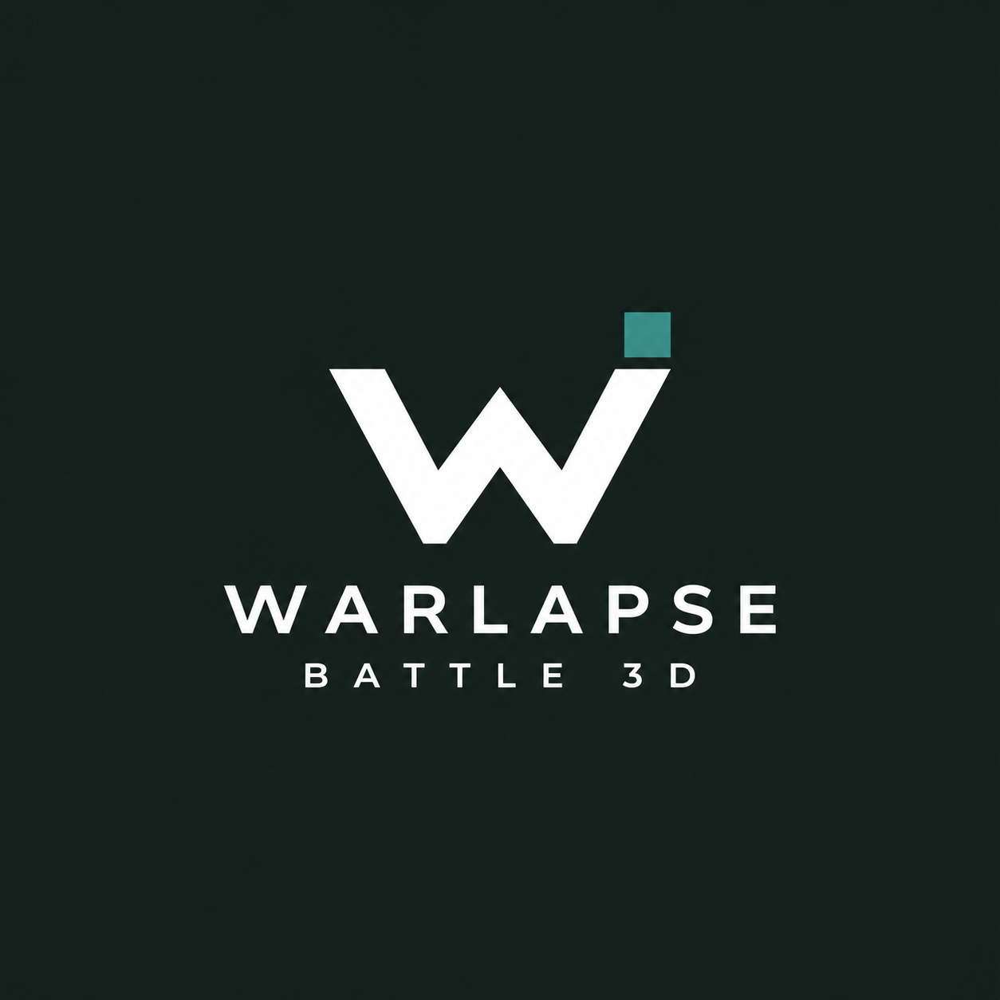
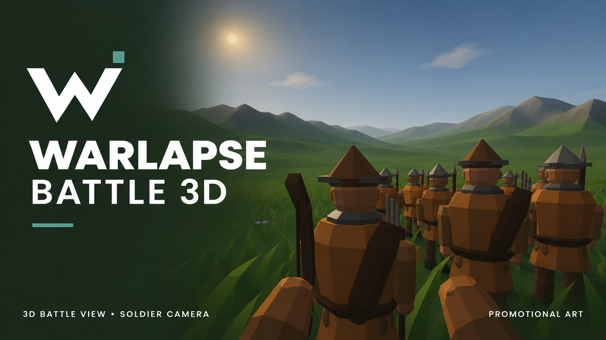
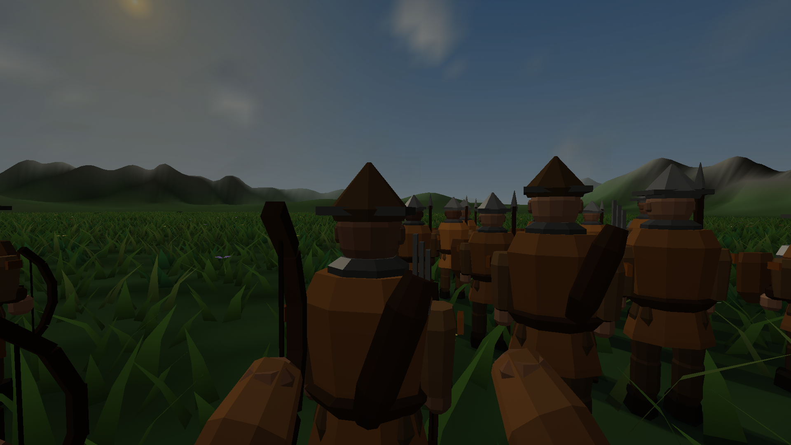
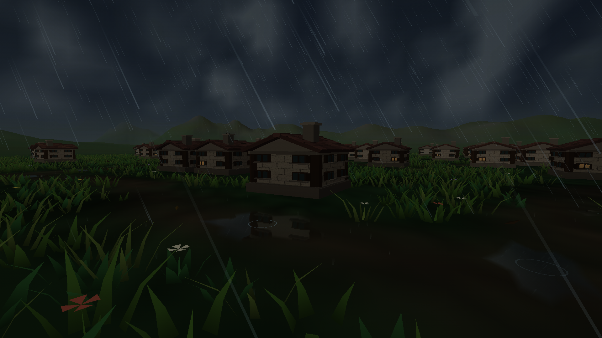

<p align="center"></p>

# Warlapse Battle 3D

**[English](#english) · [Türkçe](#turkce)**

Watch the battle from above. Experience it through a soldier's eyes.

[**Download for Windows · 7.6.1**](https://github.com/BekirXxC/Warlapse-Battle-3D/releases/latest/download/Warlapse-Battle-3D-7.6.1-Windows.zip) · [Releases](https://github.com/BekirXxC/Warlapse-Battle-3D/releases) · [Report an issue](https://github.com/BekirXxC/Warlapse-Battle-3D/issues)


*Promotional illustration / Tanıtım illüstrasyonu. Actual gameplay screenshots appear below.*

<a id="english"></a>

## English

A community-made mod for **Warlapse on Windows / Steam** that adds a 3D battlefield, era-based soldiers and vehicles, a free camera and a soldier camera to offline battles. **7.6.1** packages the 7.6.0 gameplay foundation with installation tools, bilingual mod text and publication assets.

### Download and play

1. Install **Warlapse for Windows through Steam**.
2. Download the **Windows ZIP** above and extract **all** files.
3. Run `Kur.cmd`. If the game is not found automatically, enter the folder containing `Warlapse.exe`.
4. Launch using the new desktop shortcut or `Oyunu-Ac.cmd`.
5. Start an **offline battle**, finish deployment, then press **G** to enter 3D.

The Workshop page provides the description and GitHub download link. Installation uses the Windows package from GitHub.

The installer creates a **separate game copy** at `%LOCALAPPDATA%\Warlapse-Battle3D-761` by default and applies the mod there. The modded copy and Steam game **share saves and settings**. The game itself is not included.

### Language and installed status

The mod starts in **English (ENG)**, independently of the game's language. Its installed-status message, information panel, controls and warnings use English by default. Select **TR** or **ENG** in the mod's main-menu badge to change the mod language. The same selector is available in the **3D HUD**; hold **Ctrl** to show the cursor and click it. Your explicit selection is saved for the next launch. This setting changes the mod's text; the game's own language setting is separate.

The main-menu badge shows the simple mod logo and version. Open its information panel for a short guide and the **GitHub Releases** download/update button.

### What it adds

- A 3D battlefield to explore with a free camera; return to the 2D map with G.
- A soldier camera and WASD movement for a selected soldier on your side, with independent visual positions within the formation.
- Era-based equipment, infantry, cavalry and vehicles; terrain, vegetation and softer transitions into the surrounding landscape.
- Sunlight, weather, shadows and optional enhanced graphics.

**Simulation scope:** combat, damage and battle outcomes still use Warlapse's unit-level simulation. Individual 3D movement is a visual position within that system. The 3D features are for **offline battles**.

### Controls

| Key | Action |
| --- | --- |
| G / Esc | G: toggle 2D/3D; Esc: return to 2D |
| WASD, mouse | Free-camera movement and look; in soldier control, move only the selected soldier |
| E / Q | Raise / lower the free camera |
| Left Shift / Left Alt | Free camera: faster / slower; soldier control: Shift to run |
| F | View through a soldier near the crosshair / return to free camera |
| Tab / Shift + Tab | Next soldier / visible soldier you can control |
| P | Toggle control of the soldier you are following on your side |
| Left click / right click | Soldier control: attack a visible enemy / aim zoom |
| F8 | Toggle enhanced graphics |
| Hold Ctrl | Show the pointer to use 3D HUD buttons, including TR / ENG |

Enhanced graphics start disabled. Performance varies with hardware, scene and unit count.

### Compatibility and help

The installer verifies the supported game's `Assembly-CSharp.dll` using SHA-256:

```text
9DDD3D1EA5188E4D600877E3A7939FB35180464A448F5568AB13C269B825EF20
```

If a Steam update changes this file, installation stops. Use a mod release compatible with that game build. The installer does not overwrite an existing destination; select a fresh target or remove the old modded copy first.

If PowerShell blocks a download you have verified, right-click that ZIP, choose **Properties → Unblock**, then extract it again. No system-wide execution-policy change is needed.

For custom folders, use PowerShell:

```powershell
.\Kur.ps1 -GameFolder 'D:\SteamLibrary\steamapps\common\Warlapse' -InstallFolder 'D:\Games\Warlapse-Battle3D-761'
```

To uninstall, close the game and remove **only the modded copy you created** and its desktop shortcut. Keep the shared saves folder. For bug reports, include the mod version, map, error message and steps to reproduce; review logs for personal information before sharing them.

---

<a id="turkce"></a>

## Türkçe

**Savaşı haritadan izle. Sonra bir askerin gözünden yaşa.**

Windows / Steam Warlapse için bağımsız bir topluluk modu. Çevrimdışı savaşlara 3D arazi, çağlara göre asker ve araç modelleri, serbest kamera ve asker kamerası ekler. **7.6.1**, 7.6.0 oynanışını kurulum araçları, iki dilli mod metinleri ve yayın görselleriyle sunar.

[**Windows paketini indir · 7.6.1**](https://github.com/BekirXxC/Warlapse-Battle-3D/releases/latest/download/Warlapse-Battle-3D-7.6.1-Windows.zip) · [Sürümler](https://github.com/BekirXxC/Warlapse-Battle-3D/releases) · [Hata bildir](https://github.com/BekirXxC/Warlapse-Battle-3D/issues)

<a id="indir-ve-dene"></a>

### İndir ve dene

1. Windows için **Steam Warlapse** kurulu olsun.
2. **Windows ZIP paketinin tamamını** bir klasöre çıkar.
3. `Kur.cmd` dosyasını aç. Oyun bulunamazsa `Warlapse.exe` dosyasının bulunduğu klasörü gir.
4. Masaüstü kısayolunu veya `Oyunu-Ac.cmd` dosyasını kullan.
5. **Çevrimdışı savaşta** konuşlandırmayı bitir ve **G** tuşuyla 3D'ye geç.

Workshop sayfası tanıtım ve GitHub indirme bağlantısı içindir. Kurucu, Steam oyunundan **ayrı bir kopya** oluşturur; varsayılan hedef `%LOCALAPPDATA%\Warlapse-Battle3D-761` olur. Modlu kopya ile Steam oyunu **kayıtları ve ayarları paylaşır**. Oyun pakete dahil değildir.

### Dil ve mod bilgisi

Mod, oyunun dilinden bağımsız olarak **İngilizce (ENG)** açılır. Modun kurulu olduğunu belirten durum metni, bilgi paneli, kontrolleri ve uyarıları başlangıçta İngilizcedir. Ana menüdeki mod rozetinden **TR** veya **ENG** seçebilirsin. **3D arayüzünde** de aynı seçim bulunur; **Ctrl** tuşunu basılı tutup imleci göstererek tıkla. Seçtiğin dil sonraki açılış için kaydedilir. Bu seçim modun metinlerini değiştirir; oyunun kendi dil ayarı ayrıdır.

Ana menüde sade mod logosu ve sürüm bilgisi görünür. Mod bilgi panelinde kısa kullanım yönergeleri ve **GitHub Releases** indirme/güncelleme düğmesi bulunur.

### Neler var?

- Serbest kamerayla dolaşılabilen 3D savaş alanı ve G ile 2D haritaya dönüş.
- Asker gözünden kamera; kendi tarafındaki seçili askeri WASD ile yürütme ve dizilişte bağımsız görsel konumlar.
- Çağa göre teçhizat, piyade, süvari ve araç modelleri; bitki örtüsü ve dış manzaraya yumuşak geçiş.
- Güneş, hava efektleri, gölgeler ve isteğe bağlı gelişmiş grafikler.

**Simülasyon sınırı:** saldırı, hasar ve savaş sonuçları oyunun **birlik sistemiyle** hesaplanır. Askerin bireysel 3D hareketi bu sistem içindeki görsel konumdur. 3D özellikleri **çevrimdışı savaş** içindir.

### Kontroller

| Tuş | İşlev |
| --- | --- |
| G / Esc | G: 2D–3D geçişi; Esc: 2D'ye dönüş |
| WASD, fare | Serbest kamerada hareket ve bakış; asker kontrolünde yalnız seçili askerin hareketi |
| E / Q | Serbest kamerayı yükselt / alçalt |
| Sol Shift / Sol Alt | Serbest kamerada hızlan / yavaşla; asker kontrolünde Shift ile koş |
| F | Nişangâha yakın askerin gözünden izle / serbest kameraya dön |
| Tab / Shift + Tab | Sıradaki asker / kontrol edebileceğin görünür asker |
| P | İzlediğin kendi askerinin kontrolünü aç / kapat |
| Sol tık / sağ tık | Asker kontrolünde görünür düşmana saldır / nişan yakınlaştırması |
| F8 | Gelişmiş grafikleri aç / kapat |
| Ctrl basılı tut | TR / ENG dahil 3D arayüz düğmelerini kullanmak için imleci göster |

Gelişmiş grafikler başlangıçta kapalıdır. Performans donanıma, sahneye ve birlik sayısına göre değişir.

### Uyumluluk ve yardım

Kurucu, desteklenen oyun derlemesini yukarıdaki SHA-256 özetiyle kontrol eder. Steam güncellemesi bu dosyayı değiştirirse kurulum durur; o derlemeye uygun mod sürümünü kullan. Kurucu mevcut hedefin üzerine yazmaz; güncellemede boş bir hedef seç veya eski modlu kopyayı önce kaldır.

Doğruladığın indirme PowerShell tarafından engellenirse ZIP'e sağ tıklayıp **Özellikler → Engellemeyi kaldır** seçeneğini uygula, ardından yeniden çıkar. Özel klasörler için yukarıdaki PowerShell örneğini kullanabilirsin.

Kaldırmak için oyunu kapatıp **yalnızca mod için oluşturduğun kopyayı** ve masaüstü kısayolunu sil. Ortak kayıt klasörünü silme. Hata bildirirken mod sürümü, harita, hata mesajı ve yeniden üretme adımlarını ekle; günlükleri paylaşmadan önce kişisel bilgileri gözden geçir.

## Gameplay screenshots / Gerçek oyun görüntüleri


*Malazgirt, 7.6.0 gameplay / gerçek oyun görüntüsü.*


*Berlin, 7.6.0 gameplay. 7.6.1 uses the same gameplay foundation / aynı oynanış temelini kullanır.*

## Source and publication / Kaynak ve yayın

The repository includes C# sources in `src/`, build/package tools in `tools/` and Workshop descriptions in `docs/`. Local references from a supported Steam installation are required to build; proprietary game files are not distributed. The player ZIP contains the compiled mod and installation material.

Depoda `src/` içinde C# kaynakları, `tools/` içinde derleme/paketleme araçları, `docs/` içinde Workshop metinleri bulunur. Derleme için yerel desteklenen Steam oyununun başvuruları gerekir; oyun dosyaları dağıtılmaz. Oyuncu ZIP'i derlenmiş modu ve kurulum dosyalarını içerir.

[Publication guide / Yayın rehberi](docs/YAYINLAMA.md) · [Changes / Değişiklikler](CHANGELOG.md) · [Component notices / Bileşen bildirimleri](THIRD-PARTY-NOTICES.md)
